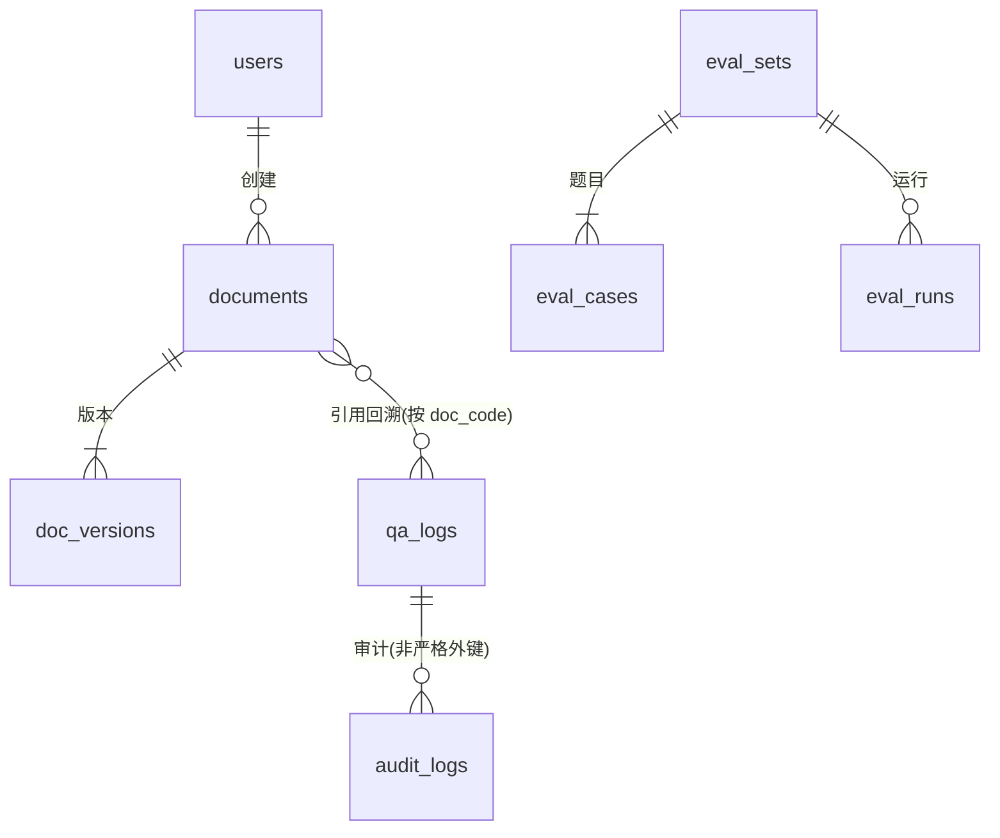

# 数据库设计 · SolarTrace

默认 SQLite（`backend/data/solartrace.db`）；生产可切 PostgreSQL（`SOLARTRACE_DATABASE_URL`）。
ORM：SQLAlchemy 2.0 声明式，模型见 `app/models/entities.py`。

## 1. ER 概览



> 向量块不落关系表，而是以 `version_id/document_id` 命名空间存于向量库 metadata；
> 文档库↔索引一致性通过对账接口校验，见《系统设计》第 4 节。

## 2. 表说明

| 表 | 关键字段 | 说明 |
| --- | --- | --- |
| `users` | username(唯一), hashed_password, display_name, role(admin/editor/viewer), is_active | 账号与角色 |
| `documents` | title, doc_code, doc_type, issuing_body, issue_year, status(draft/published/archived), current_version_id, source_file_name, checksum | 知识文档（逻辑文档） |
| `doc_versions` | document_id(FK), version_no, status, source_file_name, file_checksum, chunk_count, parent_count, published_at, archived_at | 版本；`(document_id,version_no)` 唯一 |
| `qa_logs` | user_id, question, rewritten_query, answer, sources(JSON), model, latency_ms, grounded, feedback | 问答留痕/样本回填 |
| `eval_sets` / `eval_cases` | eval_set_id, question, golden_doc_codes(JSON), golden_keywords(JSON), category | 标注评测集 |
| `eval_runs` | eval_set_id, params(JSON), case_count, hit_rate, hit_rate_top1, context_recall, faithfulness(nullable), details(JSON) | 每次评测快照与逐条明细 |
| `index_ops` | kind(seed/publish/reconcile/archive), document_id, version_id, status, detail(JSON) | 索引操作流水 |
| `audit_logs` | username, action, resource_type/id, detail(JSON), ip | 审计 |

## 3. 状态机

```
文档 Document.status:
  draft ──发布建索引──▶ published ──归档──▶ archived
  archived ──(新版本上传)──▶ 由最新 draft 发布回 published
版本 DocVersion.status: draft / published / archived
```

一致性约束：`document.current_version_id` 指向已发布版本；发布新版本先清旧向量再写新块。

## 4. 检索元数据（向量库 payload / metadata）

块级 metadata（`retrieval/types.py ChunkMeta.to_store`）：
`vector_id, document_id, version_id, doc_key, title, doc_code, doc_type, issuing_body, issue_year, status, relation, parent_seq, seq, section_path, char_len`。
`doc_key` 用于**回表校验**，`version_id` 用于版本清理。
