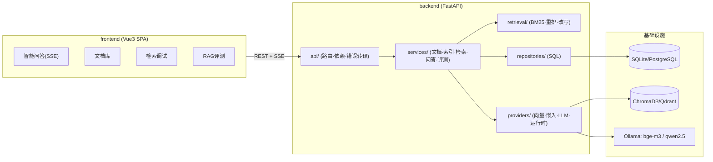

# 系统设计 · SolarTrace（光溯）

## 1. 总体架构

前后端物理分离，仅通过 HTTP/SSE 通信；后端按清晰分层组织，检索算法与外部适配器可插拔。



依赖方向：`api → services → repositories / retrieval / providers`；`providers/retrieval` 只依赖协议与 DTO，
不做业务编排 —— 保证上层可在测试中注入 Hash 嵌入 / FakeLLM / 临时向量库。

## 2. 后端分层

| 层 | 职责 | 代表文件 |
| --- | --- | --- |
| core | 配置、日志、异常、DB、安全（横切） | `core/config.py` `core/errors.py` `core/security.py` |
| models | ORM 实体与领域枚举 | `models/entities.py` `models/enums.py` |
| repositories | 数据访问收敛（doc/user/eval/qa/audit） | `repositories/doc_repo.py` … |
| services/rag | 解析、父子分块、存储路径 | `services/rag/parser.py` `chunker.py` `keys.py` `storage.py` |
| services | 用例编排：文档、索引一致性、检索、问答、评测 | `services/index_service.py` `retrieval_service.py` `qa_service.py` `eval_service.py` |
| retrieval | 检索算法与 DTO | `retrieval/bm25.py` `rewrite.py` `reranker.py` `types.py` |
| providers | 外部适配器 + 运行时装配（DI） | `providers/{vector_store,embedder,llm,registry}.py` |
| api | 路由 / 依赖（用户/角色/运行时）/ 错误转译 | `api/routes/*.py` `api/deps.py` |

## 3. 问答 / 检索主链路

```
问题 → [查询理解改写] → [稠密 bge-m3 召回] + [BM25 词法召回]
        → [RRF 融合候选池] → [两阶段精排截断 Top-K] → [回表校验文档有效性]
        → [接地提示词: 材料[1..K] + 引用要求] → [SSE 流式生成 qwen2.5]
        → [引用结构 + grounded 判定 + 问答日志]
```

要点：
- 改写器为**确定性规则**（术语归一/同义替换/扩展/类型软提示），零成本可解释；`LLM_USE_REWRITE` 预留。
- 召回池 union 稠密(30) 与 BM25(30)；RRF(k=60) 只负责**选候选**，不做绝对打分。
- 第二阶段以**绝对相关信号**打分（稠密余弦×词法覆盖×BM25 归一），再做 Top-K 截断；首条候选恒保留避免“有料空回”。
- 回表校验：`doc_key → 当前版本`，命中块若已归档/非当前版本则丢弃（引用失效政策防护）。

## 4. 文档版本化与“索引一致”

- 元模型：`Document`（知识文档）1:N `DocVersion`；发布态写在 `status` 与 `current_version_id`。
- 建索引：解析→父子分块→嵌入→以 `version_id` 命名空间写向量；
  **发布新版本前先按 `document_id` 物理清理旧向量**，保证库中每文档恰为当前版本。
- 归档：删除该文档向量；检索层回表校验兜底。
- BM25 索引：内存态，**只从向量库“status=published”数据重建**（单一数据源，避免双写漂移）；
  任何发布/归档/对账后刷新。
- 对账 `POST /system/reconcile`：比对 DB published 文档与其在向量库的版本集合，差异即重建/清理并记 IndexOp。

## 5. 向量库 / 嵌入适配

- `VectorStore` 协议：`add / delete / delete_by / query / all / count`，默认 `ChromaStore`（本地持久、免服务），
  可切 `QdrantStore`（REST，docker profile 提供），版本清理以 `version_id/document_id` 等值过滤实现。
- `Embedder` 协议：`OllamaEmbedder`（bge-m3 批量化）/ `HashEmbedder`（离线退避、测试用确定性）。
- `LLMProvider` 协议：`OllamaLLM`（流式 /api/chat）/ `FakeLLM`（离线链路演示）。

## 6. 前端（前后端分离）

- Vue3 + Vite + Element Plus SPA：`views/{Chat,SearchLab,Knowledge,Eval,Users}` + `layout/Layout`。
- `api/http.js` 注入 JWT；`api/sse.js` 用 fetch ReadableStream 解析 SSE 帧（带鉴权头，无需 EventSource cookie 限制）。
- 开发态经 Vite 代理 `/api→:8000`；生产由 nginx 托管静态资源并反代 `/api`（关闭缓冲以透传 SSE）。

## 7. 安全设计

- JWT(HS256) 访问令牌 + bcrypt 口令；三角色最小权限；停用账号即时失效。
- 所有写接口依赖角色门禁 `require_roles`；输入长度/上传类型与大小受限。
- 审计日志（登录/用户/文档写操作/对账/评测）落库，管理员可查。
